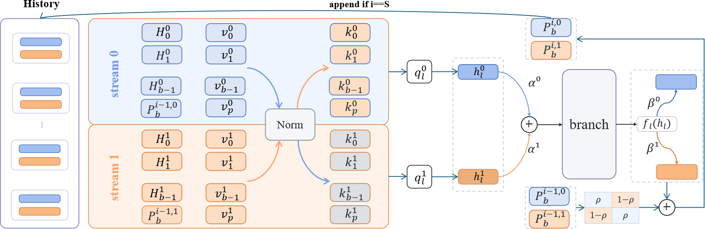

# Dual Attention Residuals

<p align="center">
  
</p>

<p align="center">
  <strong>A compact Megatron-Core implementation of dual attention residuals for large-scale MoE training.</strong>
</p>

Dual Attention Residuals (DAR) maintain a dual residual representation and
learn to read from its shared depth history before each Transformer block. This
repository provides matched Baseline, Attention Residual, and DAR training
paths so that only the residual mechanism changes across comparisons.

## Highlights

- Matched 7B Mixture-of-Experts configurations for all three residual variants.
- Optimized Triton operators with reference PyTorch paths for verification.
- Ready-to-use single-node and multi-node launchers built on Megatron-Core.

## Checkpoint

DAR weights are available on Hugging Face Hub as
`moddells/dual-attentions-residuals-60k`.

## Quick start

### Install

Python 3.10 and compatible NVIDIA GPUs are recommended.

```bash
python3.10 -m venv .venv
source .venv/bin/activate
python -m pip install --upgrade pip
python -m pip install -r requirements.txt
```

### Prepare data

The loader consumes flat `int32` token files. The included preprocessing
command streams a public corpus and creates training and validation binaries:

```bash
python data/preprocess.py \
  --dataset HuggingFaceFW/fineweb-edu \
  --subset sample-10BT \
  --split train \
  --tokenizer tokenizer/tokenizer.model \
  --output-dir data/fineweb_edu_pretok \
  --validation-tokens 10000000 \
  --add-eos
```

### Train

```bash
bash scripts/train_baseline_single_node.sh
bash scripts/train_attnres_single_node.sh
bash scripts/train_dual_single_node.sh
```

For multi-node runs, use the corresponding `*_multi_node.sh` launcher. Dataset,
output, and schedule settings can be overridden without editing the scripts:

```bash
TRAIN_TOKENS_FILE=data/fineweb_edu_pretok/train.bin \
VAL_TOKENS_FILE=data/fineweb_edu_pretok/val.bin \
OUTPUT_DIR=outputs/dual_smoke \
TRAIN_ITERS=1000 \
bash scripts/train_dual_single_node.sh
```

## Default configuration

| Setting | Value |
|---|---:|
| GPUs per node | 8 |
| Tensor / expert parallelism | 2 / 4 |
| Micro / global batch size | 4 / 128 |
| Sequence length | 4096 |
| Experts / active experts | 64 / 8 |
| Precision | BF16 |
| Sequence parallelism | Enabled |
| Activation recomputation | Selective |
| Residual operators | Optimized Triton |

## License

Released under the [MIT License](LICENSE).
